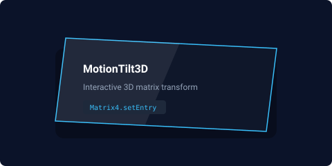
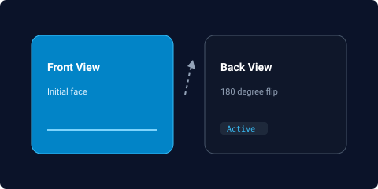
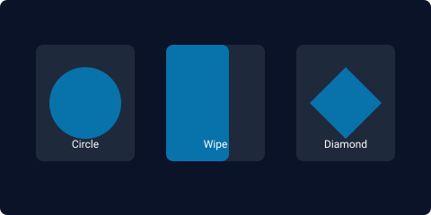
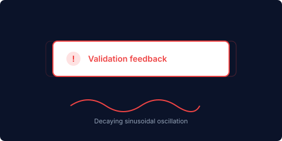
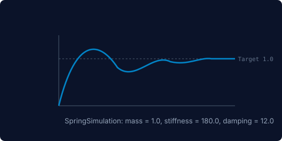

# Motion Forge

A lightweight, declarative Flutter package for fluid UI animations, interactive 3D perspective transforms, physics-driven spring motion, and staggered entrances.

## Animation Previews

| Animation | Visual Diagram | Description |
| :--- | :--- | :--- |
| **MotionTilt3D** | <br>*(Screen recording placeholder: `doc/assets/motion_tilt_3d.gif`)* | Interactive 4x4 matrix perspective rotation on touch drag or cursor hover with dynamic glare. |
| **MotionFlipCard** | <br>*(Screen recording placeholder: `doc/assets/motion_flip_card.gif`)* | 180-degree flip in 3D perspective between front and back views with backface culling. |
| **MotionMorphReveal** | <br>*(Screen recording placeholder: `doc/assets/motion_morph_reveal.gif`)* | Geometric clipping path transitions including expanding circles, directional wipes, and diamonds. |
| **MotionRipple** | <br>*(Screen recording placeholder: `doc/assets/motion_ripple.gif`)* | Expanding concentric radar rings around icons, buttons, or avatar badges. |
| **MotionShake** | <br>*(Screen recording placeholder: `doc/assets/motion_shake.gif`)* | Sinusoidal decay oscillation feedback for validation errors and attention cues. |
| **MotionSpring** | <br>*(Screen recording placeholder: `doc/assets/motion_spring.gif`)* | Physics-driven simulation with customizable mass, stiffness, and damping. |

---

## Features

- **MotionTilt3D**: Interactive 3D perspective tilt that rotates cards and widgets dynamically on hover or touch drag using 4x4 matrix transforms with optional glare overlay.
- **MotionFlipCard**: Smooth 180-degree 3D perspective flip between front and back views along horizontal or vertical axes.
- **MotionShake**: Sinusoidal decay oscillation feedback for validation errors, wrong passcodes, and attention cues.
- **MotionBlurReveal**: Cinematic focus entrance transitioning from defocus blur to razor-sharp clarity.
- **MotionRipple**: Concentric radar pulse rings expanding outward around any widget or active beacon.
- **MotionMorphReveal**: Dynamic geometric clipping path transitions (circle expand, horizontal wipe, vertical wipe, diamond expand).
- **MotionTextWave**: Sequential character or word reveal with smooth vertical translation and opacity fade.
- **MotionSpring**: Natural physics-based spring animations driven by mass, stiffness, and damping simulations.
- **MotionShimmer**: High-performance shader mask light sweep for skeletons and UI highlights.
- **MotionBreathe**: Organic breathing pulse with customizable ambient glow.
- **MotionCountNumber**: Smoothly interpolated numeric counters with custom prefixes, suffixes, and decimals.
- **MotionAccordion**: Smooth height expand and collapse transitions for panels and dropdown cards.
- **MotionFadeSlide**: Composable fade and directional slide entrance (top, bottom, left, right).
- **MotionElasticPop**: Snappy pop-in entrance with elastic overshoot.
- **StaggeredMotionGroup**: Automated sequential entrance cascades for lists and groups.
- **Fluent Extensions**: Call `.tilt3D()`, `.shake()`, `.blurReveal()`, `.ripple()`, `.shimmer()`, `.animateSpring()`, `.fadeSlide()`, or `.breathe()` directly on any Widget.

---

## Installation

Add `motion_forge` to your `pubspec.yaml`:

```yaml
dependencies:
  motion_forge: ^0.0.1
```

Then run:

```bash
flutter pub get
```

---

## Code Examples

### 1. Interactive 3D Perspective Tilt

```dart
import 'package:flutter/material.dart';
import 'package:motion_forge/motion_forge.dart';

Widget buildCard() {
  return MotionTilt3D(
    maxAngleX: 0.30,
    maxAngleY: 0.30,
    scaleOnHover: 1.05,
    glareEffect: true,
    child: Card(
      child: Padding(
        padding: const EdgeInsets.all(24.0),
        child: Text('Interactive 3D Card'),
      ),
    ),
  );
}
```

Or using widget extensions:

```dart
myWidget.tilt3D(glareEffect: true);
```

### 2. 3D Flip Card

```dart
MotionFlipCard(
  flipOnTap: true,
  front: CardFrontWidget(),
  back: CardBackWidget(),
);
```

### 3. Validation Shake

```dart
final GlobalKey<MotionShakeState> shakeKey = GlobalKey<MotionShakeState>();

MotionShake(
  key: shakeKey,
  amplitude: 14.0,
  shakes: 4,
  child: ErrorAlertWidget(),
);

// Trigger on validation failure:
shakeKey.currentState?.shake();
```

### 4. Morph Reveal Transitions

```dart
final GlobalKey<MotionMorphRevealState> morphKey = GlobalKey<MotionMorphRevealState>();

MotionMorphReveal(
  key: morphKey,
  shape: RevealShape.circle,
  duration: const Duration(milliseconds: 600),
  child: ContentCard(),
);

// Trigger programmatically:
morphKey.currentState?.reveal();
```

### 5. Concentric Ripple Rings

```dart
MotionRipple(
  ringColor: const Color(0xFF0284C7),
  maxRadius: 50.0,
  ringCount: 3,
  child: const CircleAvatar(
    child: Icon(Icons.mic),
  ),
);
```

### 6. Physics Spring

```dart
MotionSpring(
  mass: 1.0,
  stiffness: 200.0,
  damping: 12.0,
  initialScale: 0.7,
  initialOffsetY: 30.0,
  child: ActionWidget(),
);
```

### 7. Text Wave Reveal

```dart
MotionTextWave(
  text: 'Fluid animations built natively for Flutter',
  splitMode: TextWaveSplit.characters,
  staggerDuration: const Duration(milliseconds: 30),
  style: const TextStyle(fontSize: 20, fontWeight: FontWeight.bold),
);
```

### 8. Staggered Cascades

```dart
StaggeredMotionGroup(
  staggerDelay: const Duration(milliseconds: 70),
  direction: MotionDirection.bottom,
  children: const [
    ListTile(title: Text('First item')),
    ListTile(title: Text('Second item')),
    ListTile(title: Text('Third item')),
  ],
);
```

---

## Running the Showcase App

To explore all interactive animations in the gallery app:

```bash
cd example
flutter run
```

---

## License

MIT License. See the LICENSE file for details.
